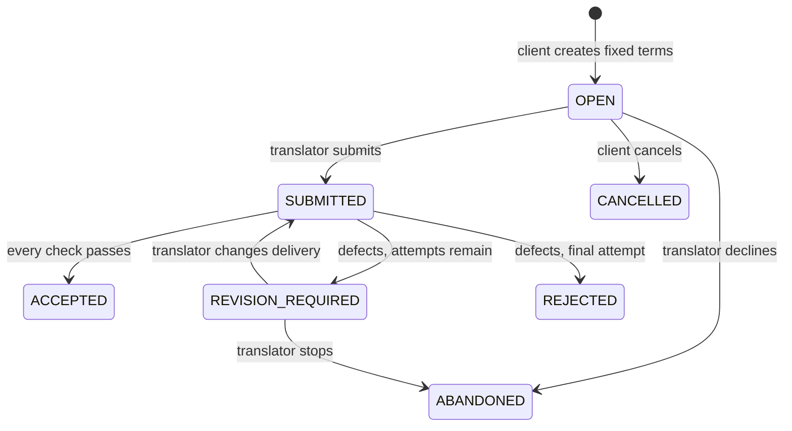

# Translation Gate

A standalone GenLayer Intelligent Contract for accepting or returning translation deliveries against an agreed rubric.

Checking that six strings arrived is easy. Checking that a Korean product description preserves an English warranty, quantity or negation needs judgment. Translation Gate separates these concerns: code enforces delivery structure and literal rules; independent AI evaluations must agree on the semantic decision before it becomes contract state.

This is an acceptance primitive for other builders, rather than a frontend or an escrow. It holds no funds and does not automatically release payments.

**Verified:** 41 local tests and official SDK validation pass. A hosted Studionet run finalized a bad translation → revision request → corrected translation → acceptance workflow. [Receipts, votes and limitations](docs/VALIDATION.md).

## Example

The source says **“AeroBottle keeps drinks cold for 24 hours.”** The agreed glossary requires **AeroBottle → 에어로보틀**.

| Delivery | Check | Result |
| --- | --- | --- |
| `음료를 24시간 동안 차갑게 유지합니다.` | Missing agreed brand translation | Deterministic revision request; no LLM call |
| `에어로보틀은 음료를 48시간 동안 차갑게 유지합니다.` | Material factual change | AI meaning check must fail; revision requested if validators agree |
| `에어로보틀은 음료를 24시간 동안 차갑게 유지합니다.` | Preserves the claim and reads naturally | Accepted if independent validators agree on all four flags |

These are illustrative expected judgments, not a promise of model accuracy. The automated tests explicitly mock model responses.

## Design

- The client fixes source segments, target language, audience, style, literal glossary, forbidden terms and a one-to-three-attempt limit **before** submission. There is no rubric-update method.
- Only the named translator may submit or revise. Submitting acknowledges the published rules.
- Source and translation must have exactly the same stable segment IDs. Segment and text budgets bound the workload.
- A deterministic gate checks empty translations, applicable glossary terms and forbidden terms. Literal failures skip AI evaluation entirely.
- For each segment that reaches AI assessment, the leader proposes four booleans: `meaning`, `complete`, `language`, `style`.
- Validators independently reassess the **same original source, delivery and rubric**. They reject a leader if any decision flag differs, even when its JSON is perfectly valid.
- The contract derives acceptance and reason codes from the flags. It stores no unverified free-form model explanation.
- Evaluation is permissionless, so a client cannot prevent it merely by refusing to call. The caller still needs network access and applicable execution fees.
- Each evaluated attempt has an immutable historical snapshot. A submitted attempt cannot be overwritten; terminal decisions cannot be rerolled. Revisions must change the delivery and are bounded by the original limit.

The last protection prevents identical delivery retries through `submit`; it does not prevent a translator from making cosmetic edits within the remaining attempt budget.

### Lifecycle



Malformed model output, provider failure or unresolved network consensus does **not** mean rejection of the translation. The evaluation transaction must not commit a new result; the last committed job remains `SUBMITTED`. A successful contract execution also needs the network's required finality before an integrating application treats it as settled.

## Run locally

Requires Python 3.12+ and network access for the first SDK download. GenVM is pinned to `v0.2.16` for reproducible local checks; the contract declares its exact runner hash in its first line.

```bash
python -m venv .venv
# Linux/macOS:
source .venv/bin/activate
# Windows PowerShell instead:
# .\.venv\Scripts\Activate.ps1
python -m pip install -r requirements-dev.txt
python -m pytest -q
python scripts/check_contract.py
```

Tests use the real GenLayer SDK and `genlayer-test` Direct Mode with mocked LLM text. `check_contract.py` runs the official AST linter and SDK schema extraction. SDK downloads stay in `.cache/gltest-direct/`; set `GLTEST_SDK_CACHE` to reuse an existing cache containing that directory name. The initial official GenVM archive is about 217 MB.

The test adapter narrowly handles two `genlayer-test==0.29.2` behaviors: Windows cannot unlink the active stdin backing file, and mock JSON is decoded even when text format was requested. Neither adapter substitutes contract logic, SDK storage or validator comparison.

See [validation evidence](docs/VALIDATION.md) for what has actually run. A local mocked test is not a live multi-validator deployment.

## Contract API

The constructor takes no arguments. Public methods are listed in the generated [schema](docs/contract-schema.json).

| Method | Caller | Purpose |
| --- | --- | --- |
| `create_job(translator, source_json, rules_json, max_attempts)` | Client | Create immutable terms; returns integer job ID |
| `submit(job_id, translation_json)` | Named translator | Initial delivery or bounded revision |
| `evaluate(job_id)` | Anyone | Apply literal gate, then semantic consensus if needed |
| `cancel(job_id)` | Client | Cancel only before any submission |
| `abandon(job_id)` | Named translator | Decline an open job or stop after revision request |
| `get_job(job_id)` | Anyone | Current job as a JSON string |
| `get_attempt(job_id, attempt)` | Anyone | Evaluated delivery and result, numbered from 1 |
| `get_next_id()` | Anyone | Next ID; existing jobs use IDs below it |

`source_json` and `translation_json` are JSON objects from segment IDs to strings. `rules_json` has exactly six fields; see [the sample job](examples/product-copy.json). Supply JSON **strings** as contract arguments, not JSON objects.

Bounds: 1–6 segments; source at most 1,200 characters per segment and 6,000 total; target at most 1,600 per segment and 8,000 total; 12 glossary entries and 12 forbidden terms. Bounds count Unicode characters, rather than encoded transaction bytes. Network transaction and resource limits still apply.

### Consumer integration

An independent escrow or work platform can reference a job ID and consume `get_job` once the evaluation transaction has finalized. Check all of the following: the contract address/network, expected client and translator, immutable source/rules, expected attempt and final `ACCEPTED` status. Do not trust an arbitrary job ID supplied by a seller. Escrow timeouts, payments, transaction fees and protocol appeals belong to the integrating application/protocol.

## Deployment

Use [GenLayer Studio](https://studio.genlayer.com/) to load `contracts/translation_gate.py` and deploy with an empty constructor. The same source may be deployed through the official CLI after selecting the intended network and compatible runner. See the [walkthrough](docs/DEPLOYMENT.md) for the exact interaction sequence and the recorded deployment status.

The tested Studionet deployment is `0xAFc70827e216828a2b5a7Bc72A3edB30306724B4` (chain 61999). Its finalized receipts and readbacks are recorded under `deployments/`. This hosted development deployment uses a disposable test account, not the Portal-linked user wallet.

## Scope and limitations

- Source, translations, rules and reports are public on-chain data. Do not submit confidential client material.
- Model agreement is not proof of linguistic truth. Shared bias, prompt injection and inconsistent judgments remain possible. See [the threat model](docs/SECURITY.md).
- Substring glossary rules are deliberately literal, using Unicode NFKC and case folding. They do not understand word boundaries, inflection or contextual terminology. Choose terms accordingly.
- This contract has no per-job clock or expiry and no fund custody. A submitted job can remain pending if nobody pays to evaluate or consensus cannot be reached.
- It is intended for bounded translation tasks, not legal, medical or other high-stakes certification.

## Sources

Built against the official [GenLayer equivalence principle](https://docs.genlayer.com/developers/intelligent-contracts/equivalence-principle), [storage reference](https://docs.genlayer.com/developers/intelligent-contracts/features/storage), and [testing documentation](https://docs.genlayer.com/developers/intelligent-contracts/testing). The application, rubric, state machine, literal gates and tests in this repository are specific to this primitive.

MIT licensed.
